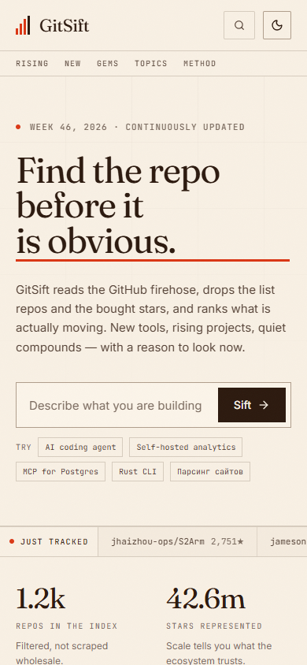

# GitSift

**Найдите репозиторий раньше, чем он станет очевидным.**

GitSift — открытый радар новых и быстрорастущих репозиториев GitHub. Он читает публичный поток,
выбрасывает форки, списки и накрученные звёзды, ранжирует то, что действительно движется, и
объясняет в одном абзаце, почему на это стоит потратить субботний вечер.

Один процесс Node и локальный файл SQLite. Без API-ключей, без внешних сервисов, без телеметрии.

[](https://github.com/leonka123/gitsift/actions/workflows/ci.yml)
[](LICENSE)
[](package.json)
[](#быстрый-старт)
[](CONTRIBUTING.md)


## Чем плох рейтинг по звёздам

GitHub Trending сортирует по общему числу звёзд, то есть награждает прошлое. Проект пятилетней
давности с 80k звёзд стоит выше трёхнедельного инструмента, который набирает 200 звёзд в день.
И ни один из них не отвечает, живой ли код и подходит ли он вашей задаче.

GitSift ранжирует импульс, а не величину:

| | GitHub Trending | GitSift |
| --- | --- | --- |
| Что в основе рейтинга | сумма звёзд | звёзды/день, возраст, активность, качество |
| Всплески звёзд | не видны | штрафуются bot score |
| Мёртвые и архивные проекты | в общей куче | отфильтрованы до подсчёта |
| «Зачем мне это?» | ничего | факт «почему сейчас» и идея на выходные |
| Поиск | по ключевым словам | гибрид лексики и смысла, английский и русский |
| Код | закрыт | MIT, self-hosted, проверяемый |

Формула открыта, покрыта тестами и описана на [странице метода](src/app/about/page.tsx) и в
[`src/lib/scoring.ts`](src/lib/scoring.ts).

## Что внутри

- **Rising** — живой реестр, по строке на репозиторий, у каждого перцентиль на пятиступенчатой
  шкале сигнала.
- **New** — проекты, созданные за последние 7 / 30 / 90 дней, без длинной истории звёзд за спиной.
- **Hidden gems** — 20–900 звёзд и минимум 1.5 звезды в день: ещё достаточно маленькие, чтобы
  мейнтейнер отвечал в issues.
- **Семантический поиск** — опишите задачу, а не ключевое слово. FTS5 + эмбеддинги + reciprocal
  rank fusion, с расширением концептов на английском и русском.
- **Еженедельный выпуск** — двенадцать записей с «почему сейчас» и идеей на выходные, плюс RSS.
- **Публичный API** — те же данные, что и на страницах, без авторизации.

<table>
  <tr>
    <td width="50%"></td>
    <td width="50%"></td>
  </tr>
  <tr>
    <td><em>Поиск по смыслу: «self-hosted analytics» → plausible/analytics, ClickHouse, langfuse.</em></td>
    <td><em>На странице репозитория — оценка, траектория и соседи по теме.</em></td>
  </tr>
</table>

<details>
<summary><strong>Тёмная тема</strong></summary>


</details>

## Быстрый старт

Нужен только **Node.js 22+**.

```bash
git clone https://github.com/leonka123/gitsift.git
cd gitsift
npm install
npm run dev
```

Откройте <http://localhost:3000>. При первом запуске GitSift загружает встроенный срез из
**1 240 репозиториев** — реальные публичные метаданные — считает рейтинг, пишет саммари и
эмбеддинги, собирает текущий выпуск. Это занимает меньше минуты, дальше база лежит в
`data/gitsift.db`.



> Срез — это снимок, а не живое зеркало. Для обновления запустите `npm run ingest`.

### Docker

```bash
docker build -t gitsift .
docker run --rm -p 3000:3000 -v gitsift-data:/app/data gitsift
```

Образ заполняет базу при первом старте; именованный том сохраняет последующие ingest-прогоны.

## Как считается рейтинг

Сырой балл — взвешенная сумма пяти сигналов, затем перцентиль по всему индексу:

```text
raw = 0.50 · momentum      // log1p(stars_per_day · 7)
    + 0.16 · scale         // log10(stars + 1)
    + 0.14 · freshness     // 1 - age_days / 1100
    + 0.10 · activity      // 1 - days_since_push / 120
    + 0.24 · quality       // эвристика, 0..1

signal = percentile(raw × (0.55 + 0.45 · trust))   // 0..100
trust  = 1 - bot_score
```

Оценка 99 значит, что 99% отслеживаемых репозиториев в этот день набрали меньше. Quality prior
смотрит на длину README, лицензию, тесты, CI, релизы и скорость ответа в issues; bot score
штрафует всплески звёзд, не подкреплённые ростом форков и контрибьюторов.

## Поиск

Два независимых поиска, объединённых reciprocal rank fusion:

1. **Лексический** — SQLite FTS5 BM25 по именам, описаниям, темам и фрагментам README.
2. **Семантический** — косинусная близость по 384-мерным эмбеддингам.

Перед поиском запрос расширяется небольшим словарём концептов на английском и русском
(`src/lib/topics.ts`). Если настроен ключ LLM, верхние кандидаты переранжируются, и каждый
результат получает конкретную причину.

```bash
# Английский
curl "http://localhost:3000/api/search?q=self-hosted%20analytics&limit=5"

# Русский
curl "http://localhost:3000/api/search?q=инструмент%20для%20парсинга%20сайтов&limit=5"
```

По умолчанию эмбеддинг лексический (`hash-384-v1`): быстро, бесплатно, офлайн. Метафору он не
поймёт — для этого есть `EMBEDDINGS_PROVIDER=openai`.

## Обновление из GitHub

```bash
cp .env.example .env
# GITHUB_TOKEN поднимает лимит API с 60/ч до 5 000/ч
npm run ingest
```

`npm run ingest` выполняет шестнадцать поисковых запросов, подтягивает README перспективных
новичков, пишет снапшоты звёзд, пересчитывает сигнал, обновляет саммари и эмбеддинги и собирает
выпуск. Без токена тоже работает — просто медленнее.

Планировщик: workflow в `.github/workflows/ingest.yml`, cron или любой внешний вызов:

```bash
curl -X POST https://your-deployment.example/api/cron/ingest \
  -H "Authorization: Bearer $CRON_SECRET"
```

## Деплой

SQLite нужен постоянный диск, поэтому serverless без внешней базы не подходит. Готовые пути:

- **Docker** на любом хосте с томом (Fly.io, Railway, Render, VPS).
- **Fly.io** с volume — см. [`fly.toml`](fly.toml) и [`docs/DEPLOY.md`](docs/DEPLOY.md).
- **Небольшой VPS** с `npm run build && npm start` за Caddy или nginx.

Перед публикацией задайте `NEXT_PUBLIC_SITE_URL` (canonical, sitemap, RSS, OG) и `CRON_SECRET`.

## API

Без авторизации и ключей, с кэшированием.

```bash
GET /api/repos?mode=rising&limit=12
GET /api/repos?mode=new&windowDays=30&language=Python&limit=12
GET /api/repos?mode=gems&minStars=50&topic=mcp
GET /api/search?q=self-hosted+analytics&limit=10&selfHosted=1
```

`mode` — `rising | new | gems | top`. В ответе оценка, звёзды в день, темы, саммари и ссылка на
GitHub. Тело README не отдаётся, только его длина.

## Команды

| Команда | Что делает |
| --- | --- |
| `npm run dev` | Заполняет базу при первом запуске и поднимает dev-сервер. |
| `npm run build` / `npm start` | Прод-сборка и сервер. |
| `npm run db:reset` | Пересобрать базу из встроенного среза. |
| `npm run ingest` | Обновить репозитории из GitHub. |
| `npm run pipeline` | ingest → score → summarize → embed → digest. |
| `npm run typecheck` / `npm test` | TypeScript и юнит-тесты. |

## Ограничения

Честный список, потому что рейтинг, который нельзя проверить, — это ещё один чёрный ящик:

- Звёзды — прокси внимания, а внимание покупается. Bot score ловит грубые всплески, но не
  изощрённые кампании.
- Индекс молодой: качество растёт вместе с историей ежедневных снапшотов.
- Поисковые запросы задают пороги по звёздам, свежести и темам; тихие проекты ниже порога
  остаются невидимыми, пока не начнут двигаться.
- Эмбеддинг по умолчанию лексический, а не нейросетевой.

## Дорожная карта

Что сделано и что дальше — в [`docs/ROADMAP.md`](docs/ROADMAP.md). Коротко: хостинг демо, больше
истории снапшотов, сохранённые поиски и более широкое покрытие тем. Там же — чего в проекте не
будет: платных мест, купленных звёзд и логина поверх публичных данных.

## Участие

Issues и pull requests приветствуются. Хорошие первые задачи:

- Добавить алиас темы или расширение запроса на русском/английском.
- Улучшить антиспам-эвристику с реальным примером, где она ошибается.
- Добавить поисковый запрос для недооценённого угла экосистемы.
- Улучшить доступность или производительность страницы, которой пользуетесь.

Сначала прочитайте [CONTRIBUTING.md](CONTRIBUTING.md). Участвуя, вы соглашаетесь с
[Code of Conduct](CODE_OF_CONDUCT.md).

Если GitSift сэкономил вам вечер — **поставьте звезду**: так его найдёт следующий.

## Лицензия

MIT. См. [LICENSE](LICENSE).

GitSift не связан с GitHub. Данные репозиториев приходят из публичного GitHub API; рейтинг —
субъективный и вычисленный, а не одобренный мейнтейнерами.
